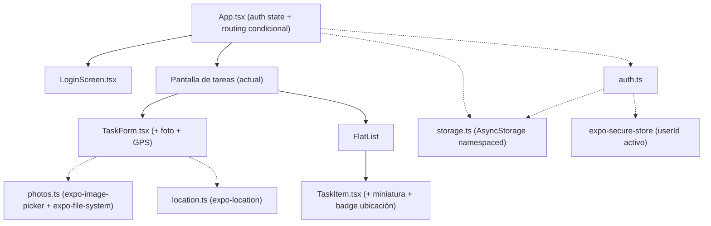
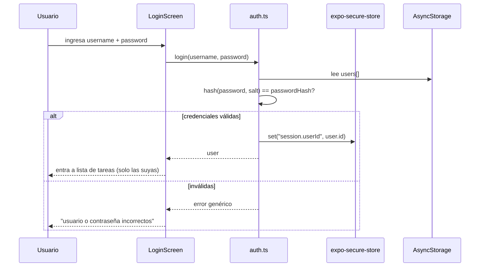
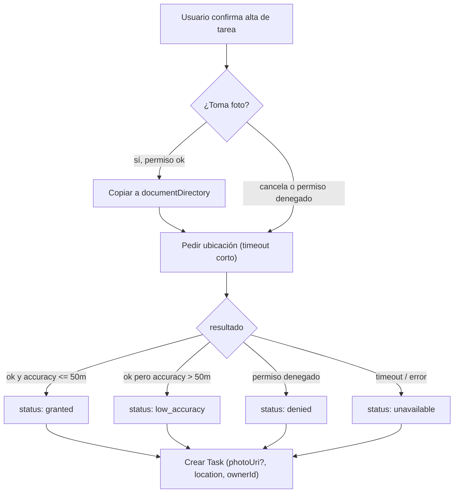

# 4. Diseño

## Árbol de componentes



- `App.tsx` reemplaza su único `useState<Task[]>` por: `currentUser` (desde `auth.ts`,
  restaurado al abrir la app vía `expo-secure-store`) y, si hay sesión, las tareas de
  `storage.ts` filtradas/namespaced por `currentUser.id`.
- Sin usuario activo → se renderiza `LoginScreen`, no la lista. Mismo patrón condicional
  que ya existe para `editingTask`.

## Flujo: login / registro



Registro: mismo flujo sin paso de verificación de hash; valida `username` único contra
`AsyncStorage` antes de generar `salt` + `passwordHash` y crear el `User`.

## Flujo: alta de tarea con foto + GPS (no bloqueante)



Invariante clave: **el nodo `Save` siempre se alcanza**. Ninguna rama de foto o GPS
lanza/propaga una excepción que impida crear la tarea; errores se capturan en
`photos.ts`/`location.ts` y se traducen a `null`/`status` correspondiente.

## Permisos just-in-time

- Nunca se pide permiso de cámara o ubicación al abrir la app ni al montar `TaskForm`.
- Se pide exactamente cuando el usuario presiona "Tomar foto" (cámara) o al confirmar el
  alta de la tarea (ubicación), vía `requestCameraPermissionsAsync` /
  `requestForegroundPermissionsAsync`.
- Si el usuario ya denegó permanentemente ("No volver a preguntar" en Android / denegado
  en iOS), `canAskAgain === false`: la UI muestra el estado correspondiente
  (`denied`/sin foto) sin loop de reintento ni crash.

## Persistencia (claves `AsyncStorage`)

| Clave | Contenido |
|---|---|
| `users` | `User[]` (passwordHash, nunca password plano) |
| `tasks:<userId>` | `Task[]` solo de ese usuario — namespacing, no filtro en memoria |

`expo-secure-store`:

| Clave | Contenido |
|---|---|
| `session.userId` | `User.id` de la sesión activa (o ausente = no logueado) |

## Almacenamiento de fotos (filesystem)

```
documentDirectory/
  photos/
    <ownerId>/
      <taskId>.jpg
```

Namespacing por `ownerId` en disco además de en `AsyncStorage`: refuerza el aislamiento
(un usuario no puede referenciar accidentalmente el archivo de otro) y simplifica borrar
todo lo de un usuario si hiciera falta.

## UI: cambios sobre componentes existentes

- `TaskForm.tsx`: agrega botón "Tomar foto" (preview chica si ya hay una) y ya no necesita
  UI de ubicación manual — se captura automáticamente al confirmar.
- `TaskItem.tsx`: agrega miniatura (`Image` desde `photoUri`) si existe, y un badge de
  texto corto según `location.status` (`📍 registrada` / `📍 baja precisión` /
  `📍 sin ubicación`), sin bloquear ni alterar el layout si `photoUri`/`location` son
  `null` (mismo patrón condicional que ya usa para `description`).
